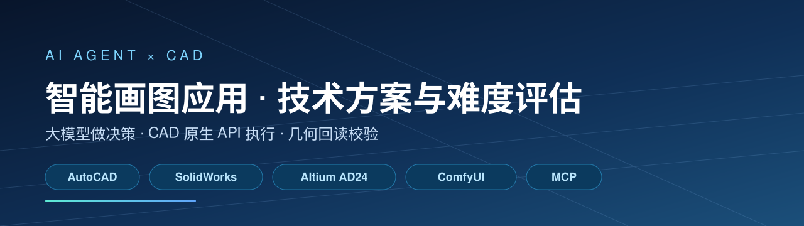
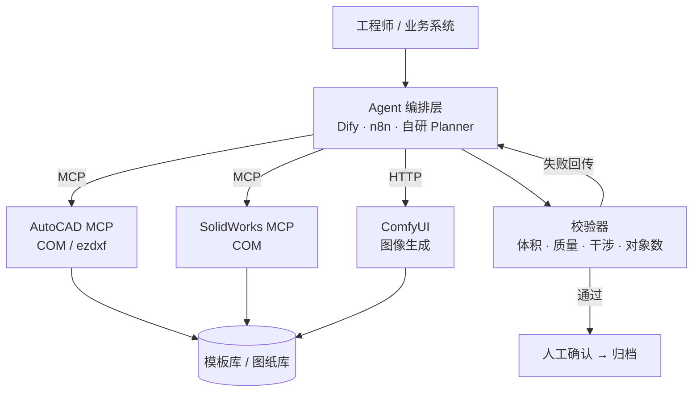

# AI CAD Agent Playbook

> 用现成的大模型 + MCP + CAD 原生 API，把 SolidWorks / AutoCAD / Altium / AI 绘画接成"能出图"的智能体：技术路线、可复用代码与难度评估。




---

## 一句话

**不是"文生图 / 文生 CAD"，而是"大模型做决策 + CAD 原生 API 执行 + 几何回读校验"的闭环智能体。**

端到端生成 STEP/DWG 的模型目前只能做概念件；能进生产图纸的路线只有一条：让模型选模板、填参数、调 API，再由程序回读几何证明"它真的画对了"。

## 这是什么

一份面向工程落地的**技术方案 + 可行性调研**，回答四个问题：

1. AutoCAD、SolidWorks、Altium Designer 24、AI 绘画这四类"智能画图"分别能做到什么程度？
2. 用现成的 AI 工具（LLM、MCP、ComfyUI、Dify）具体怎么调用、怎么串起来？
3. 每一块的难度、工期、成本、风险分别是多少？
4. 哪些方向应该立刻做、哪些应该缓、哪些根本不该立项？

配套一份 15 章、约 2.8 万字符的中文技术报告（[Markdown](docs/ai-cad-agent-playbook.zh-CN.md) / [Word](docs/ai-cad-agent-playbook.zh-CN.docx)），含 Python / DelphiScript / ComfyUI 调用示例与 API 参数说明。

## 这不是什么

- ❌ 不是一个开箱即用的 CAD 插件或 SaaS
- ❌ 不承诺"一句话生成可投产的 PCB / 装配体"
- ❌ 不包含任何厂商的私有 SDK、破解工具或未授权数据
- ✅ 是一份可以照着排期、照着写代码、照着说服老板（或被老板说服）的工程文档

## 三个反直觉的结论

| # | 结论 | 为什么 |
|---|---|---|
| 1 | **模板化 > 生成式** | 让模型"发明几何"的成功率约 30%，让它"选模板、填参数、查结果"能到 90% |
| 2 | **校验器比模型重要** | 每个写操作后回读体积/质量/包围盒/干涉，偏差超阈值就回滚；没有这一步，图纸不敢用 |
| 3 | **瓶颈是数据不是模型** | 项目 60–70% 工作量在图纸标准化：图层、图框、单位、模板、版本 |

## 能力域速览

| 能力域 | 用现成工具怎么调 | 难度 | 单人 MVP | 生产可用 |
|---|---|---|---|---|
| AutoCAD 智能画图 | LLM → 绘图指令 JSON → COM / DXF；现成 `autocad-mcp`（240+ 工具） | ★★☆ | 4–6 周 | 2–3 月 |
| SolidWorks 建模与工程图 | 参数表 + 方程式/配置驱动；`solidworks-mcp`（COM，自带几何自检） | ★★★★ | 8–12 周 | 4–6 月 |
| Altium Designer 24 | 只能做脚本、BOM、DRC、批量改图；无官方 AI 生成接口 | ★★★★★ | 3 月仅到"辅助" | 不建议全自动 |
| AI 绘画 / 效果图 | ComfyUI HTTP API + ControlNet 锁结构 + LoRA 锁风格 | ★★★ | 3–4 周 | 1–2 月 |
| 图纸理解 / 知识库 | VLM + OCR + 规则 + RAG | ★★★ | 6–8 周 | 3 月 |

> 完整矩阵（技术难度 × 数据依赖 × 集成风险 × 业务风险 × 优先级）见报告第 10 章。

## 架构



一次工具调用长这样（MCP JSON-RPC）：

```json
{
  "jsonrpc": "2.0",
  "id": 7,
  "method": "tools/call",
  "params": {
    "name": "draw_line",
    "arguments": { "x1": 0, "y1": 0, "x2": 6000, "y2": 0, "layer": "AI_WALL" }
  }
}
```

## 15 分钟阅读路径

| 你是 | 读这几章 |
|---|---|
| 第一次接触 | [第 0 章 结论](docs/ai-cad-agent-playbook.zh-CN.md) → 第 10 章 难度矩阵 → 第 14 章 做/缓/不做 |
| 要落地 | 第 3 章 AutoCAD → 第 4 章 SolidWorks → 第 9 章 三个端到端场景 |
| 要评估立项 | 第 11 章 成本 → 第 12 章 风险 → 第 13 章 岗位映射与 90 天验收 |
| 只想一周做个 demo | 附录 B「一周 demo 清单」 |

## 目录结构

```text
.
├── README.md
├── docs/
│   ├── ai-cad-agent-playbook.zh-CN.md     # 技术报告（Markdown 源）
│   └── ai-cad-agent-playbook.zh-CN.docx   # 排版版（封面 / 目录 / 页码）
├── tools/
│   └── md2docx.py                          # 报告用到的 Markdown → DOCX 转换脚本
├── assets/
│   └── banner.svg
├── CONTRIBUTING.md
├── CHANGELOG.md
└── LICENSE
```

## 工具：md2docx.py

报告里的 Word 版由仓库内的脚本生成，不依赖 pandoc / LibreOffice：

```bash
python3 -m venv .venv && . .venv/bin/activate
pip install python-docx
python tools/md2docx.py docs/ai-cad-agent-playbook.zh-CN.md docs/ai-cad-agent-playbook.zh-CN.docx
```

支持标题层级、管道表格（自动列宽 + 表头跨页重复）、代码块、引用、有序/无序列表、A4 页边距与页脚页码。

## 适合谁

- 制造业 / 硬件公司的**数字化、信息化、研发效率**岗位
- 想做 CAD 二次开发 + LLM 结合的**全栈工程师**
- 正在评估"要不要立项 AI 画图"的**技术负责人**
- 准备面试 AI 应用岗、需要一份能讲清楚的**作品集**

## 不适合谁

- 想要"输入一句话，输出可投产 PCB"的人（目前不存在这样的方案）
- 期待开箱即用产品的人（这是方案与示例，不是软件）

## Roadmap

- [x] v1.0：技术方案与难度评估（15 章 + 2 附录）
- [ ] v1.1：补充 AutoCAD 绘图指令集（op schema）与最小执行器
- [ ] v1.2：SolidWorks 参数化模板示例（.prtdot 骨架 + 参数表）
- [ ] v1.3：ComfyUI 线稿转效果图的最小工作流（API 格式 JSON）
- [ ] v2.0：MCP Server 参考实现（AutoCAD / SolidWorks）

## 贡献

欢迎补充真实踩坑、修正 API 细节、提交新的场景案例。请先读 [CONTRIBUTING.md](CONTRIBUTING.md)。

## English

A practical playbook for building AI agents that actually drive CAD software. The core idea is simple:
**the LLM plans, native CAD APIs execute, and a geometric read-back step verifies** — text-to-CAD models alone
cannot produce production drawings.

Covers AutoCAD (COM / DXF / MCP), SolidWorks (COM, parametric templates, drawings), Altium Designer 24
(scripts, BOM/DRC — no AI generation API), AI image generation (ComfyUI + ControlNet + LoRA), drawing
understanding (VLM/OCR/RAG) and agent orchestration. The full report is in Chinese, with code samples and a
difficulty / cost / risk matrix.

## 许可与免责

- 代码（`tools/`）：[MIT](LICENSE)
- 文档（`docs/`、`README`）：[CC BY 4.0](docs/LICENSE)

本文档为个人技术研究，不代表任何雇主或厂商立场；所涉 SolidWorks、AutoCAD、Altium Designer 等为各自公司商标，本项目与其无隶属关系。文中价格为量级估算，以厂商官网为准。

---

如果这份文档帮你少走了一个月弯路，欢迎点个 ⭐。
